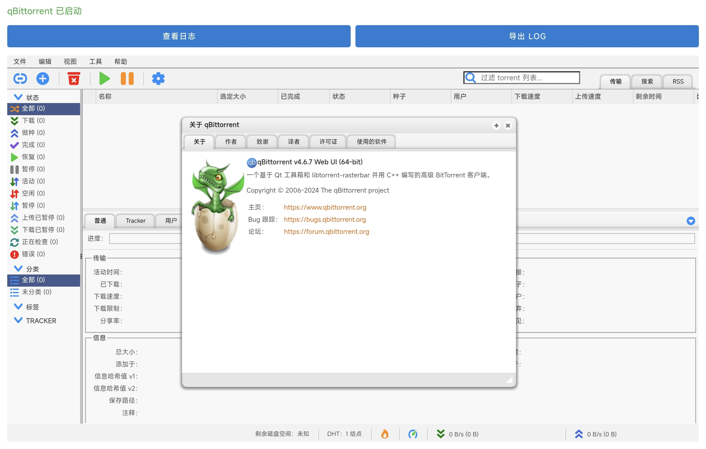

  

<h1 align="center">qBittorrent for Android</h1>

  在 Android 上原生运行 qBittorrent，内置 WebUI（ARM64）。 
  Run qBittorrent natively on Android with a built-in WebUI.

  
  
  
  

  

## 简介

把 [qBittorrent](https://github.com/qbittorrent/qBittorrent) 编译为共享库，在 Android 应用进程内
通过 JNI 运行，界面用 WebView 访问 WebUI。内置 [VueTorrent](https://github.com/Yizhou147/VueTorrent)
2.34.0 中文默认版，可切换回原生 WebUI；支持多个 qBittorrent 版本以独立包名共存。

## 下载

当前 [release v1.2.3](https://github.com/Yizhou147/qbittorrent-android/releases/tag/v1.2.3)：

| 版本 | 包名 | 应用名 | 说明 |
|---|---|---|---|
| **5.3.1** | `com.qbittorrent.android` | qBittorrent | 最新，推荐 |
| 4.6.7 | `com.qbittorrent.android.qb467` | qBittorrent 4.6.7 | Qt5 + libtorrent 2.0 |
| 4.3.9 | `com.qbittorrent.android.qb439` | qBittorrent 4.3.9 | Qt5 + libtorrent 1.2 |

- 文件命名：`qbittorrent-android-<版本>-v<tag>.apk`
- 仅支持 **arm64-v8a**；安装下限 Android 7.0，实测 Android 11 及以上
- 5.2.3 / 5.2.4 / 5.3.0 可从历史 release 获取，包名见 [FAQ](docs/FAQ.md)
- 构建矩阵支持的完整版本见 [构建指南](docs/BUILDING.md)

> 不推荐进行 PT 下载，强行使用后果自负。

## 功能特性

- 完整 qBittorrent 功能，通过 WebUI 操作
- 内置 VueTorrent 2.34.0 中文默认 WebUI，可切换原生 WebUI
- 支持 BT / 磁力链接 / 种子文件上传
- 可自定义 WebUI 端口与默认下载目录
- 多版本并存（独立包名，互不影响）
- 多语言界面（含简体中文）

## 快速开始

1. 安装 APK 并打开，等待初始化完成（约 10–30 秒）
2. 默认地址 `http://localhost:8080`，用户名 `admin`，密码 `adminadmin`
3. 修改语言：WebUI → 设置 → WebUI → 语言

## 构建

- **推荐**：GitHub Actions 工作流 `Build qBittorrent Android APK`（`all` 或单版本）
- **本地**：`./scripts/prepare-sources.sh <版本>` + Docker + Gradle

签名、Qt 运行时库、本地构建步骤与目录结构见 [docs/BUILDING.md](docs/BUILDING.md)。

## 文档

| 文档 | 内容 |
|---|---|
| [构建指南](docs/BUILDING.md) | 版本矩阵、CI / 本地构建、签名、目录结构 |
| [移植笔记](docs/PORTING.md) | JNI、TLS、rcc、Boost 异常跨 DSO 等移植问题 |
| [测试](docs/TESTING.md) | patch-check、单元测试、模拟器冒烟、真机脚本 |
| [FAQ](docs/FAQ.md) | 设备要求、密码端口、包名共存、HTTPS |
| [更新日志](CHANGELOG.md) | 版本历史 |

## 致谢

- [qBittorrent](https://github.com/qbittorrent/qBittorrent) / [libtorrent](https://www.libtorrent.org/)
  / [Qt](https://www.qt.io/) / [OpenSSL](https://www.openssl.org/)
- [VueTorrent](https://github.com/WDaan/VueTorrent)（本项目使用其中文默认版 fork 2.34.0）

## 许可证

本项目遵循 [GPL-3.0 License](LICENSE)。qBittorrent 本身遵循 GPLv2+。
